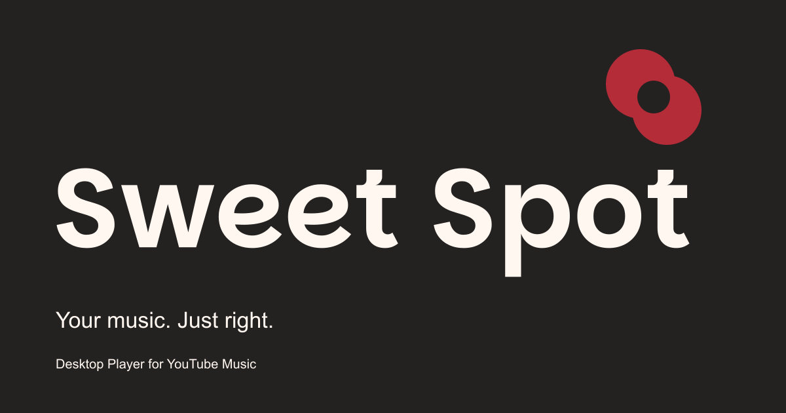
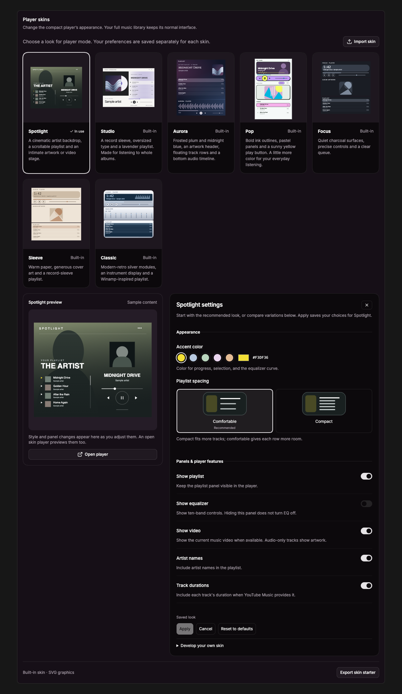
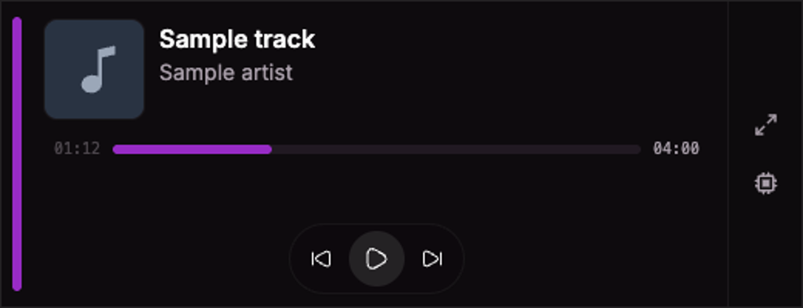
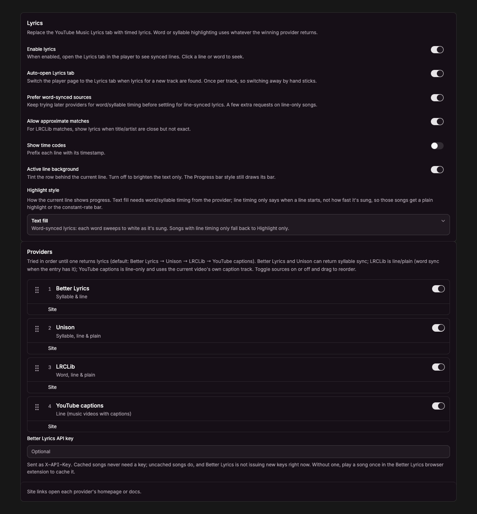
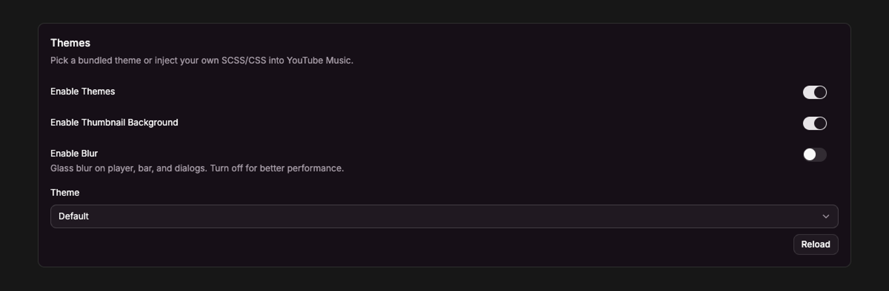

<h2 align="center">
    Sweet Spot for YouTube Music (sweetspot)
</h2>

<p align="center">
Your music. Just right. Desktop Player for YouTube Music.
</p>

Website: [sweetspot.bkk.ooo](https://sweetspot.bkk.ooo). App updates and downloads are published through [GitHub Releases](https://github.com/hybridknight/sweetspot/releases).

<p align="center">
  
</p>

<p align="center">
  <a href="https://github.com/hybridknight/sweetspot/releases/latest"></a>
  
</p>

## Features

### Player mode and sound

Seven built-in player skins, a ten-band equalizer with presets, consistent volume, smooth play/pause, and optional song fades.



### Tray view

Compact now-playing popup from the system tray.



### Lyrics

Timed lyrics in the player (Better Lyrics, Unison, LRCLIB).



### Themes

Bundled or custom SCSS/CSS for the YouTube Music UI.



### Shared links (`ssytm://`)

Open tracks, playlists, and channels in the app (`ssytm://` or swap `https://` on music.youtube.com URLs).

More detail in [`apps/docs/content/docs/features`](./apps/docs/content/docs/features).

### Protected local credentials

Sweet Spot encrypts paired-client credentials and lets your operating system protect the encryption keys. On macOS, this uses Keychain. Disposable caches do not request keychain access, and pairing storage opens only when needed. Read the [local data and privacy guide](apps/docs/content/docs/internals/encrypted-stores.mdx) for what a macOS permission prompt means.

## Project setup

Monorepo (pnpm). App: [`apps/sweetspot`](./apps/sweetspot).

```bash
# gh required for the native media package on GitHub Packages
gh auth refresh -s read:packages
pnpm deps:install

# Optional: copy local app settings (GitHub repository, website, etc.)
cp apps/sweetspot/.env.local.example apps/sweetspot/.env.local

pnpm dev
```

`pnpm deps:install` uses your GitHub CLI login (or `NODE_AUTH_TOKEN`) for private package access through a temporary configuration.

## License

The desktop app and documentation use [CC0-1.0](LICENSE). The [userscript](packages/userscript/LICENSE) retains its separate MIT license. Third-party dependencies and assets retain their original licenses and required notices, including the [Inter font license](apps/docs/assets/fonts/inter-OFL.txt).

## Inspiration

The upstream desktop music community and th-ch / Pear Desktop inspired a lot of my own work on this project: ideas, approaches, and the wider desktop YouTube Music space. Also Better Lyrics and LRCLIB. Grateful they exist.

## Contributors

<a href="https://github.com/hybridknight/sweetspot/graphs/contributors">
  
</a>

<p align="center">
  <picture>
    <source media="(prefers-color-scheme: dark)" srcset="https://api.star-history.com/svg?repos=hybridknight/sweetspot&type=Date&theme=dark" />
    <source media="(prefers-color-scheme: light)" srcset="https://api.star-history.com/svg?repos=hybridknight/sweetspot&type=Date" />
    
  </picture>
</p>

### AI assistants & MCP

Connect a desktop AI assistant from **Settings → AI & MCP**. The opt-in, localhost-only MCP server exposes current playback and queue information, with optional playback controls and mandatory paired-client tokens. Follow the [MCP setup guide](apps/docs/content/docs/integrations/mcp.mdx).
