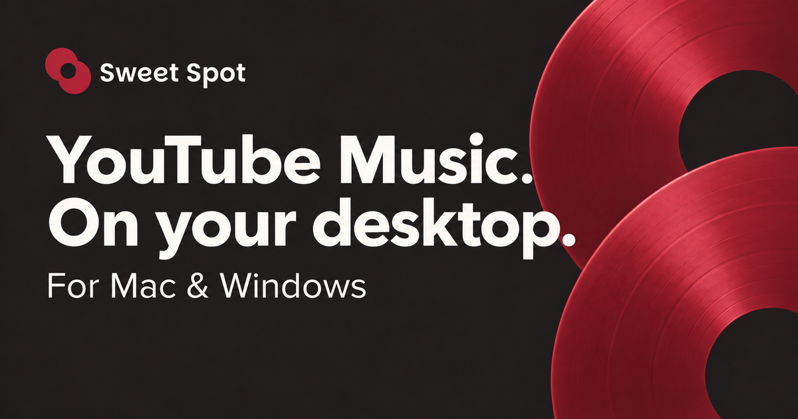

<h1 align="center">Sweet Spot</h1>

<p align="center">
  Make room for music.<br />
  Your desktop home for YouTube Music.
</p>

<p align="center">
  <a href="https://sweetspot.bkk.ooo">Website</a> ·
  <a href="https://github.com/hybridknight/sweetspot/releases">Downloads</a> ·
  <a href="https://sweetspot.bkk.ooo/docs">Documentation</a>
</p>

<p align="center">
  
</p>

<p align="center">
  <a href="https://github.com/hybridknight/sweetspot/releases/latest"></a>
  
</p>

Sweet Spot brings YouTube Music into a dedicated desktop player with customizable skins, thoughtful sound controls, synced lyrics, and optional connections to your AI assistant.

## Get started

1. Download a build for your computer from [the website](https://sweetspot.bkk.ooo) or [GitHub Releases](https://github.com/hybridknight/sweetspot/releases).
2. Install Sweet Spot and sign in to YouTube Music.
3. Open **Settings → Appearance → Player skins** to choose a look and open the dedicated player.

See the [installation guide](https://sweetspot.bkk.ooo/docs/install) for platform details and first-launch help.

## Make it yours

| Feature | What you can do |
| --- | --- |
| [Player skins](https://sweetspot.bkk.ooo/docs/features/player) | Choose from seven built-in looks and customize the player’s panels, colors, and layout. |
| [Sound controls](https://sweetspot.bkk.ooo/docs/features/equalizer) | Shape playback with a ten-band equalizer, presets, and automatic headroom. |
| [Playback](https://sweetspot.bkk.ooo/docs/features/playback) | Keep volume consistent, soften play and pause, add optional song fades, and watch supported music videos. |
| [Synced lyrics](https://sweetspot.bkk.ooo/docs/features/lyrics) | Follow timed lyrics from Better Lyrics, Unison, LRCLib, and YouTube captions. |
| [Themes](https://sweetspot.bkk.ooo/docs/features/themes) | Style the full YouTube Music interface with built-in themes or your own CSS, SCSS, or Sass. |
| [Tray controls](https://sweetspot.bkk.ooo/docs/features/tray-view) | Check what’s playing and control music from a compact tray popup. |
| [Shared links](https://sweetspot.bkk.ooo/docs/features/shared-links) | Open tracks, playlists, and channels in the app through `ssytm://` links. |

## Connect your tools

Enable **Settings → AI & MCP** to connect a compatible desktop AI assistant. The opt-in MCP server provides current playback and queue information, with optional playback controls. It runs on localhost and requires a paired-client token.

For your own scripts and integrations, Sweet Spot also exposes a local HTTP and WebSocket API.

- [Set up MCP](https://sweetspot.bkk.ooo/docs/integrations/mcp)
- [Explore the local API](https://sweetspot.bkk.ooo/docs/api)

Paired-client credentials are encrypted, with their encryption keys protected by the operating system. On macOS, this uses Keychain. Read the [local data and privacy guide](https://sweetspot.bkk.ooo/docs/internals/encrypted-stores) for storage details and permission prompts.

## Develop locally

Build and run the desktop app on Windows or macOS. You’ll need **Node.js 24.14+**, **pnpm 11+** (the repository pins its version in `package.json`), and **GitHub CLI** access to the native media dependency on GitHub Packages.

From the repository root:

```bash
gh auth login
gh auth refresh -s read:packages
pnpm deps:install
pnpm dev
```

If you’re already signed in to GitHub CLI, skip `gh auth login`. The dependency installer uses that login, or `NODE_AUTH_TOKEN`, through a temporary configuration.

To customize local repository and website settings, copy the optional environment file before starting:

```bash
cp apps/sweetspot/.env.local.example apps/sweetspot/.env.local
```

Development uses a separate app profile from installed releases. See [Build from source](https://sweetspot.bkk.ooo/docs/build) for profile behavior, native dependencies, and packaging instructions.

### Workspace

| Path | Purpose |
| --- | --- |
| [`apps/sweetspot`](apps/sweetspot) | Electron desktop app |
| [`apps/docs`](apps/docs) | Website and documentation |
| [`packages/userscript`](packages/userscript) | Browser userscript for shared links |

### Useful commands

| Command | Purpose |
| --- | --- |
| `pnpm dev` | Start the desktop app in development mode |
| `pnpm build` | Type-check and build the desktop app |
| `pnpm test` | Run the test suite |
| `pnpm docs:dev` | Start the documentation website |
| `pnpm docs:build` | Build the documentation website |
| `pnpm build:win` / `pnpm build:mac` | Package the desktop app for the selected platform |

## Inspiration

Inspired by the upstream desktop music community, th-ch / Pear Desktop, Better Lyrics, and LRCLIB. Their work helped shape the ideas and approaches behind Sweet Spot.

## License

The desktop app and documentation use [CC0-1.0](LICENSE). The [userscript](packages/userscript/LICENSE) retains its separate MIT license. Third-party dependencies and assets retain their original licenses and required notices, including the [Inter font license](apps/docs/assets/fonts/inter-OFL.txt).

<p align="center">
  <picture>
    <source media="(prefers-color-scheme: dark)" srcset="https://api.star-history.com/svg?repos=hybridknight/sweetspot&type=Date&theme=dark" />
    <source media="(prefers-color-scheme: light)" srcset="https://api.star-history.com/svg?repos=hybridknight/sweetspot&type=Date" />
    
  </picture>
</p>
